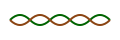

<p align="center">
  
</p>

<h1 align="center">🕯️ Celtic Calendar 🕯️</h1>

<p align="center">
<b><i>“May the knots of time reveal the wisdom of the ancients.”</i></b>
</p>

<p align="center">
  
</p>

<p align="center">
<b>A C project for exploring, simulating, and visualizing the ancient Celtic calendar system, with astronomical precision and festival lore.</b>
</p>

<p align="center">
<pre>
┏━━━━━━━━━━━━━━━━━━━━━━━━━━━━━━━━━━━━━━━━━━━━━━━━━━━━━━┓
┃      ⌘⌘⌘⌘⌘⌘⌘⌘⌘⌘⌘⌘⌘⌘⌘⌘⌘⌘⌘⌘⌘⌘⌘⌘⌘⌘⌘⌘⌘⌘⌘⌘⌘⌘⌘⌘⌘⌘⌘⌘⌘⌘⌘⌘    ┃
┃      Celtic Calendar — Coligny Tablet Simulation     ┃
┃      ⌘⌘⌘⌘⌘⌘⌘⌘⌘⌘⌘⌘⌘⌘⌘⌘⌘⌘⌘⌘⌘⌘⌘⌘⌘⌘⌘⌘⌘⌘⌘⌘⌘⌘⌘⌘⌘⌘⌘⌘⌘⌘⌘⌘    ┃
┗━━━━━━━━━━━━━━━━━━━━━━━━━━━━━━━━━━━━━━━━━━━━━━━━━━━━━━┛
</pre>
</p>

---


## ✨ Features & Functionality

- **Celtic Calendar Simulation**
  - Visualizes months, days, and the unique structure of the Coligny calendar.
  - Months are now ordered with Giamonios ("winter month") as the first month, aligning the year start with Samhain (winter's beginning).
  - Highlights the dual coicise (half-months), intercalary months, and authentic day counts.
- **Astronomical Calculations**
  - Computes Julian Day, lunar phases, solar positions, and zodiac signs for any date.
- **Festival Detection**
  - Automatically marks major Celtic festivals (Samhain, Imbolc, Beltane, Lughnasadh) and astronomical cross-quarters.
- **TUI (Terminal User Interface)**
  - Navigate the calendar with arrow keys in a modestly decorated, knotwork-inspired interface.
  - ASCII/Unicode art, color highlights, and Celtic knot motifs throughout.
- **Coligny Tablet Notation**
  - Displays reconstructed day notations, auspicious/inauspicious days, and festival markers as on the original bronze tablet.
- **Search & Navigation**
  - Jump to any Gregorian date, move forward/backward by lunar months, or return to today.
- **Test & Debug Utilities**
  - Standalone programs for validating astronomical and calendar logic.

---


## 🗓️ Coligny Month Order (Current)

| # | Month Name      | Abbreviation |
|---|-----------------|--------------|
| 1 | Giamonios       | GIA          |
| 2 | Simivisonnos    | SIM          |
| 3 | Equos           | EQU          |
| 4 | Elembivios      | ELE          |
| 5 | Aedrinios       | AED          |
| 6 | Cantlos         | CAN          |
| 7 | Samonios        | SAM          |
| 8 | Dumannios       | DUM          |
| 9 | Riuros          | RIV          |
|10 | Anagantios      | ANA          |
|11 | Ogronnios       | OGR          |
|12 | Cutios          | CUT          |

This order starts the year with Giamonios ("winter month"), matching the Samhain tradition.

## 🗂️ Project Structure

```
├── astronomy.c/h         # Astronomical calculations
├── calendar.c/h          # Calendar logic
├── data.c/h              # Data tables and constants
├── festivals.c/h         # Festival logic
├── glyphs.c/h            # Unicode/ASCII rendering, Coligny notation
├── main.c                # Main entry point
├── main_interactive.c    # TUI entry point
├── ui_ncurses.c/h        # Terminal UI (ncurses)
├── celtic_calendar_tui   # Main TUI executable
├── test_*.c              # Test and debug programs
└── .dist/                # (Optional) Build outputs
```

---


## 🖼️ Example Output

<p align="center">

</p>

---

## 🏺 Original Archaeological Artifact

<p align="center">
  
  <br/>
  <i>The bronze Coligny Calendar tablet, discovered in France (1st century CE).</i>
</p>

---


## ⚙️ Build & Run

```bash
# Build the TUI (recommended):
gcc -Wall -O2 main_interactive.c ui_ncurses.c glyphs.c data.c astronomy.c festivals.c calendar.c -lncursesw -lm -o celtic_calendar_tui

# Run the interactive Celtic Calendar:
./celtic_calendar_tui

# Or build and run the CLI version:
gcc -Wall -O2 main.c astronomy.c calendar.c data.c festivals.c glyphs.c -lm -o celtic_calendar
./celtic_calendar

# Check the calendar still matches the sky (moon phases, Pliny's sixth day, Samhain in Samonios):
gcc -Wall -I. -o test_calendar tests/test_calendar.c astronomy.c calendar.c -lm
./test_calendar
```

---


## 📚 References

- [Coligny Calendar (Wikipedia)](https://en.wikipedia.org/wiki/Coligny_calendar)
- [Celtic Festivals](https://en.wikipedia.org/wiki/Celtic_calendar#Festivals)

---

## 📝 License

MIT License. See `LICENSE` file for details.

---

## 🙏 Acknowledgements

- Images: Wikimedia Commons
- Research: Academic and open-source Celtic calendar reconstructions

---


<p align="center">
  
</p>
